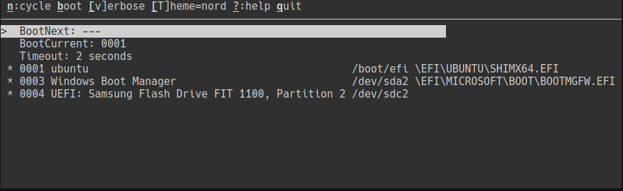

# EfiBootDude

`efibootdude` is a curses TUI for `efibootmgr`: edit the UEFI boot menu and boot parameters while running Linux.

* Install: `pipx install efibootdude`
* Requires Python 3.11+ and [rhboot/efibootmgr](https://github.com/rhboot/efibootmgr) (Debian/Ubuntu: `sudo apt install efibootmgr`).



It covers the common `efibootmgr` operations: reorder, enable/disable, copy, and remove boot entries; set BootNext; change the timeout; write changes and reboot. Copy creates a new entry under a different label. For anything else, use `efibootmgr` directly.

## Usage

Run as your normal user (not `sudo`); the app elevates only the `efibootmgr`/`reboot` commands that need root.

Keys are contextual: the top line lists what applies to the current row, and you type the underscored letter. Press `?` for full help, navigation keys, and a glyph check.

* `u` / `d` — move the current entry up or down in the boot order
* `t` — relabel the entry (prompts for a new name)
* `c` — copy the entry under a new label
* `r` — remove the entry, or undo a pending copy/removal
* `*` — toggle whether the entry is active
* `m` — set the boot timeout (seconds)
* `n` — choose the next boot entry (BootNext)
* `w` — write pending changes
* `b` — reboot
* `q`, `x`, or Ctrl-C — quit
* `ESC` — abandon changes and reload from firmware

`+ADD` marks pending copies and `-RMV` marks entries awaiting removal. At the top, `BootCurrent` (read-only), `BootNext`, and `Timeout` summarize the current firmware state; entries prefixed with `*` are active. Nothing is written until `w`, and the exact commands are shown for confirmation first. `NO_COLOR` starts in the monochrome theme; `T` cycles themes.

## Caveats (Firmware and efibootmgr Quirks)

* Some operations may not stick even when `efibootmgr` reports success (e.g., relabeling); copy the entry and remove the old one instead.
* Some changes only take effect after a reboot.
* **`Boot0000` and `efibootmgr` v18 bug:** `--bootnum 0000` fails with `Boot entry 0 not found`, so `efibootdude` cannot relabel, activate/deactivate, or delete that entry.
    * Reordering still works (the order is written with `--bootorder`).
    * To change its attributes, copy the entry and work with the copy (e.g., relabel it and move it to the top); you can delete `0000` in the firmware setup screen, but `0000` may be reused by a later create.
* Firmware may silently rewrite or ignore parts of the boot order; if results look wrong, compare against the firmware setup screen.

## Privileges

`efibootdude` runs as your user and calls `sudo` only for generated `efibootmgr`/`reboot` invocations, keeping the blast radius to those commands. It prints the command list and asks before running anything — read it before confirming. To avoid prompts, scope `sudo` to just the two binaries:

```
youruser ALL=(root) NOPASSWD: /usr/sbin/efibootmgr, /sbin/reboot
```

Boot-menu changes are persistent firmware writes; a bad entry can leave a machine unbootable, so keep a recovery USB.

## About

Inspired by [Elinvention/efiboots](https://github.com/Elinvention/efiboots). `efibootdude` aims to install easily outside distro repos, show each entry's partition (mount point or device path), and display the underlying commands for verification and troubleshooting.
